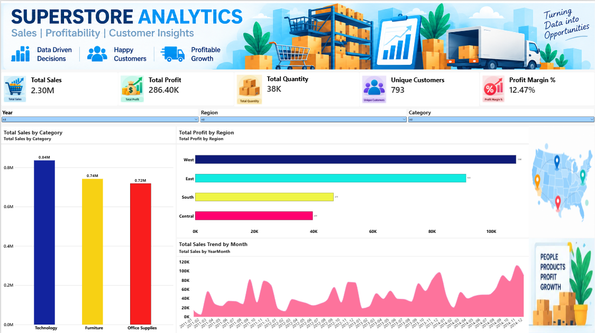
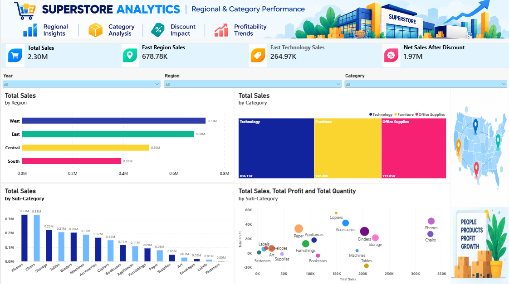

# 📊 Superstore Sales & Profitability Analytics

### Interactive Power BI Dashboard Project

An interactive, two-page Power BI dashboard project built to analyze Superstore sales, profitability, customer insights, regional performance, and product trends.

The project combines KPI tracking, DAX calculations, data modeling, and interactive visualizations to turn sales data into meaningful business insights.

---

## 🎯 Project Objectives

* Analyze overall sales and profitability.
* Compare sales performance across regions.
* Identify leading product categories and sub-categories.
* Explore monthly sales trends.
* Examine the relationship between sales and profit.
* Estimate sales after applying recorded discount rates.
* Present business performance through interactive dashboards.

---

## 📈 Dashboard 1: Sales & Profitability Overview



This dashboard provides a high-level overview of business performance through key metrics and sales visualizations.

### Key Performance Indicators

| KPI              |         Value |
| ---------------- | ------------: |
| Total Sales      | $2,297,200.86 |
| Total Profit     |   $286,397.02 |
| Total Quantity   |        37,873 |
| Unique Customers |           793 |
| Profit Margin    |        12.47% |

### Key Features

* KPI cards for sales, profit, quantity, unique customers, and profit margin.
* Category-wise sales analysis covering Technology, Furniture, and Office Supplies.
* Region-wise profit comparison.
* Monthly sales trend visualization.
* Interactive filters for Year, Region, and Category.

---

## 🌎 Dashboard 2: Regional & Category Performance



This dashboard provides a more detailed view of regional sales, product category contributions, and sub-category performance.

### Key Performance Indicators

| KPI                      |             Value |
| ------------------------ | ----------------: |
| Total Sales              |             2.30M |
| East Region Sales        |           678.78K |
| East Technology Sales    |           264.97K |
| Net Sales After Discount | 1.97M — estimated |

### Key Features

* Sales comparison across West, East, Central, and South regions.
* Category contribution analysis using a treemap.
* Sub-category sales comparison.
* Sales vs. Profit analysis using a scatter chart.
* Interactive Year, Region, and Category filters.

---

## 🧮 DAX Measures

DAX measures were created to calculate KPIs and support interactive analysis.

### 1. Total Sales

```dax
Total Sales = SUM(Orders[Sales])
```

### 2. Total Profit

```dax
Total Profit = SUM(Orders[Profit])
```

### 3. Total Quantity

```dax
Total Quantity = SUM(Orders[Quantity])
```

### 4. Unique Customers

```dax
Unique Customers =
DISTINCTCOUNT(Orders[Customer ID])
```

### 5. Profit Margin %

```dax
Profit Margin % =
DIVIDE([Total Profit], [Total Sales], 0)
```

### 6. East Region Sales

```dax
East Region Sales =
CALCULATE(
    [Total Sales],
    Orders[Region] = "East"
)
```

### 7. East Technology Sales

```dax
East Technology Sales =
CALCULATE(
    [Total Sales],
    Orders[Region] = "East",
    Orders[Category] = "Technology"
)
```

### 8. Category Contribution %

```dax
Category Contribution % =
DIVIDE(
    [Total Sales],
    CALCULATE(
        [Total Sales],
        REMOVEFILTERS(Orders[Category])
    ),
    0
)
```

### 9. Net Sales After Discount — Estimated

```dax
Net Sales After Discount =
SUMX(
    Orders,
    Orders[Sales] * (1 - Orders[Discount])
)
```

**Note:** The Net Sales After Discount measure estimates the sales amount after applying the recorded discount rate. It should not be treated as verified net revenue without confirming how discounts are represented in the source dataset.

---

## 🔗 Data Modeling

The project uses an Orders table and a Date table to support time-based analysis.

* Created a relationship between `Date[Date]` and `Orders[Order Date]`.
* Used a one-to-many relationship, with the Date table on the one side.
* Used the date relationship to support year-based filtering.
* Added interactive slicers for Year, Region, and Category.

The model allows users to explore the report dynamically by changing the selected filters.

---

## 🛠️ Tools & Technologies

| Tool / Technique           | Purpose                                                   |
| -------------------------- | --------------------------------------------------------- |
| Microsoft Power BI Desktop | Dashboard development and report design                   |
| DAX                        | KPI calculations and analytical measures                  |
| Data Modeling              | Relationships between the Date and Orders tables          |
| Data Visualization         | Charts, KPI cards, treemap, and scatter plot              |
| Business Intelligence      | Exploring business performance and communicating insights |

---

## 💡 Business Questions Explored

1. Which region generates the highest sales?
2. Which product category contributes the most to sales?
3. Which sub-categories generate the highest sales?
4. How are sales and profit related?
5. What is the estimated sales amount after applying recorded discounts?
6. How does sales performance change over time?

---

## 🧠 Skills Demonstrated

* Power BI dashboard development
* DAX measures and KPI calculations
* Data modeling and relationships
* Interactive report design
* Sales and profitability analysis
* Regional and category performance analysis
* Data visualization
* Business reporting and data storytelling

---

## 🚀 How to Explore the Project

1. Download `Superstore_Analytics.pbix` from this repository.
2. Open the file in Microsoft Power BI Desktop.
3. Navigate between the two report pages.
4. Use the Year, Region, and Category slicers to filter the data.
5. Interact with the charts to explore sales, profitability, and product performance.

---

## 👩‍💻 Author

**Ramya Achar**

Aspiring Data Analyst | Power BI | SQL | Python | Data Science

* GitHub: [RamyaAchar34](https://github.com/RamyaAchar34)
* LinkedIn: [Connect with me](https://www.linkedin.com/in/ramya-achar-916b8b327)

---

*This project demonstrates how interactive Power BI dashboards can transform sales data into meaningful insights and support data-driven business analysis.*
